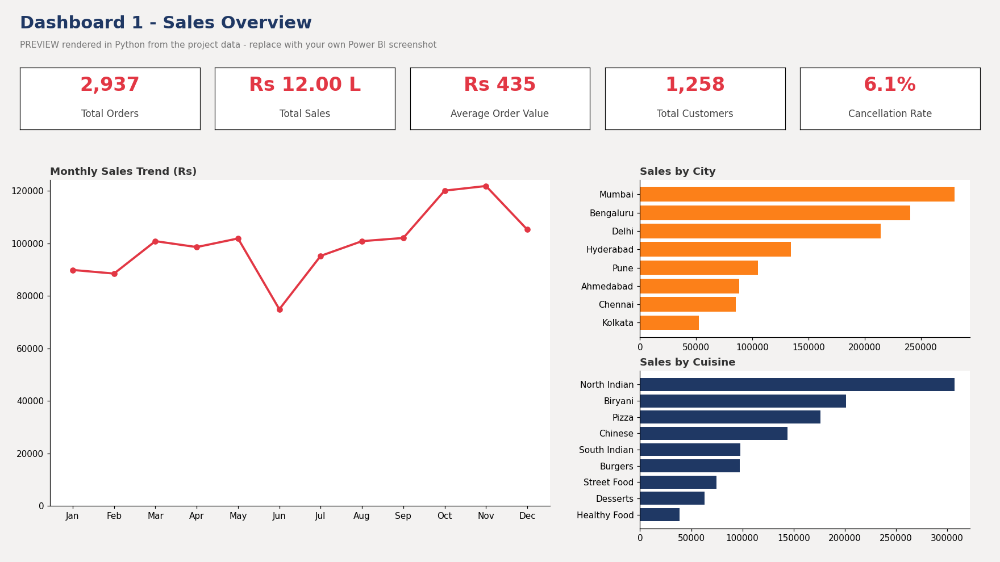
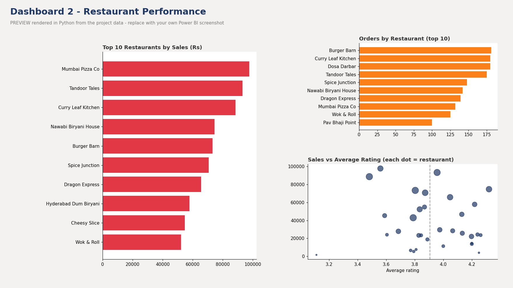
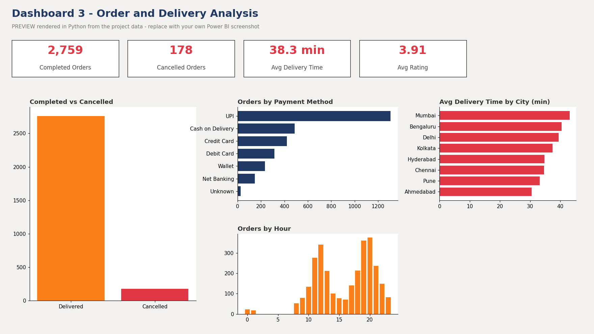

# Food Delivery Data Analysis using Excel, SQL (MySQL) and Power BI

End-to-end analytics project on a **synthetic** Swiggy/Zomato-style order dataset (Indian cities, Rs). It covers data cleaning in Excel, business analysis in MySQL, and an interactive Power BI dashboard with DAX.

> **Data disclaimer:** all data is synthetic (generated for learning). Restaurant names are fictional. Order-level data from real platforms is not public. Average order value is calibrated to publicly reported Swiggy/Zomato figures (about Rs 428).

## Business questions
Which cities, restaurants and cuisines drive sales? Which month is strongest? How many orders are cancelled and why? Where is delivery slow? What should the business do about it?

## Key findings (calculated from the data)
| Metric | Result |
|---|---|
| Orders / Completed / Cancelled | 2,937 / 2,759 / 178 |
| Total sales (delivered) | Rs 11,99,696 |
| Average order value | Rs 434.83 |
| Cancellation rate | 6.06% (Cash on Delivery 10.45% vs UPI 5.13%) |
| Top city by sales | Mumbai (23.3%) |
| Top restaurant by sales | Mumbai Pizza Co (Rs 97,665) |
| Most popular cuisine | North Indian (622 orders) |
| Best month | November (Rs 1,21,839) |
| Slowest cities | Mumbai 43.1 min, Bengaluru 40.4, Delhi 39.5 (avg 38.3) |
| Repeat customers | 62.2% |

## Project structure
```
data/        raw CSV (3,057 rows), cleaned CSV (2,937 rows), dim_restaurants.csv, dim_city.csv
excel/       Food_Delivery_Cleaning_Workbook.xlsx  (formula-driven cleaning, log, summary, formula lab)
sql/         01_create_tables_and_load.sql, 02_analysis_queries.sql (25 queries)
powerbi/     dax_measures.dax, food_delivery_theme.json  (+ your .pbix after you build it)
screenshots/ dashboard images (previews included; replace with your Power BI screenshots)
docs/        guides, insights, interview prep
```

## How to run
1. Open the Excel workbook and read `README` and `Cleaning_Log`.
2. MySQL: edit `DATA_PATH` in `sql/01_create_tables_and_load.sql`, run it, then run `02_analysis_queries.sql`.
3. Power BI: follow `docs/03_PowerBI_Dashboard_Guide.md`; paste measures from `powerbi/dax_measures.dax`.

## Business rules
Sales = `quantity x unit_price - discount` for **Delivered** orders only. AOV = Sales / Delivered orders. Cancellation rate = Cancelled / all orders.

## Skills demonstrated
Excel (TRIM, IF, IFERROR, COUNTIFS, SUMIFS, INDEX-MATCH/XLOOKUP, Remove Duplicates, PivotTables, Conditional Formatting) | MySQL (GROUP BY, HAVING, CASE WHEN, JOINs, subqueries, window functions) | Power BI (star schema, slicers, Top N) | DAX (CALCULATE, DISTINCTCOUNT, DIVIDE) | data storytelling.

## Documentation
`docs/00_Project_Documentation.md`, `01_Dataset_and_Excel_Cleaning_Guide.md`, `02_SQL_Analysis_Guide.md`, `03_PowerBI_Dashboard_Guide.md`, `04_DAX_Measures_Guide.md`, `05_Business_Insights.md`, `06_Resume_and_Interview_Prep.md`.

## Dashboard previews




## Author
Chendhil Kumar | [LinkedIn](https://www.linkedin.com/in/your-profile) | [GitHub](https://github.com/your-username)
